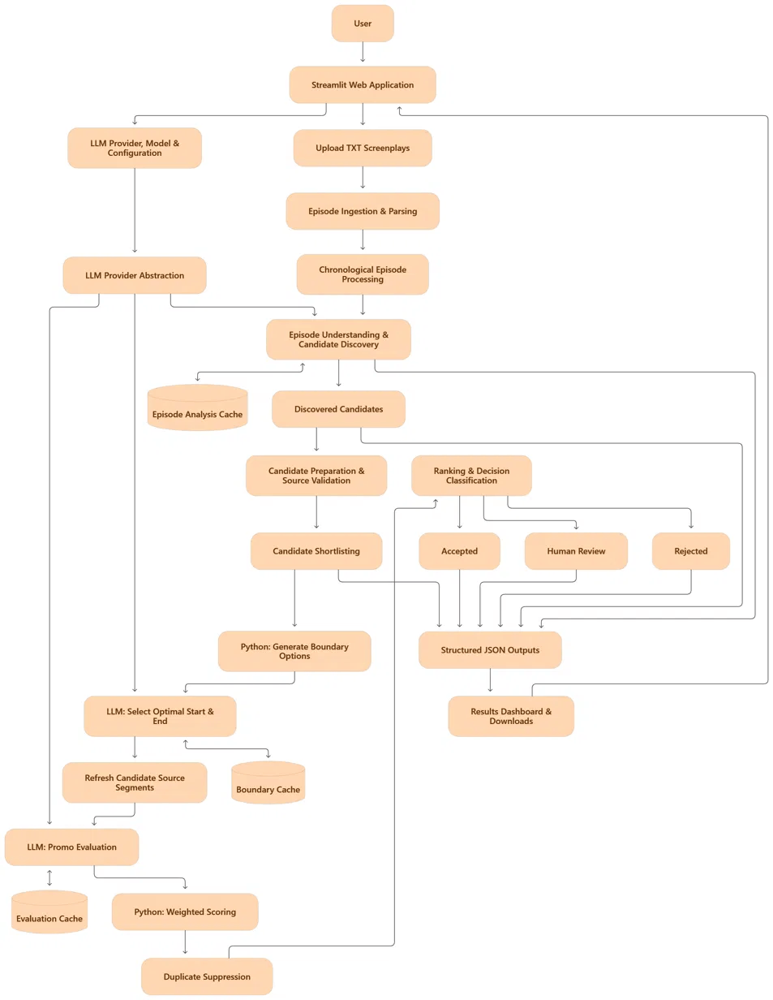

# Kuku FM Promotional Moment Discovery System

An AI-assisted Python pipeline for discovering, optimizing, evaluating, and ranking promotional moments from screenplay episodes.

## 1. Project Setup

### Prerequisites

- Python 3.10 or later
- Google Gemini API key (or OpenAI API key)

### Install dependencies

Clone or extract the project and navigate to its root directory:

```bash
cd "Assignment Solution"
pip install -r requirements.txt
```

### Configure API credentials

Create a `.env` file in the project root.

For Google Gemini:

```env
GOOGLE_API_KEY=your_api_key_here
```

The client also accepts `GEMINI_API_KEY`.

For OpenAI, if using that provider:

```env
OPENAI_API_KEY=your_api_key_here
```

Keep API credentials private and do not commit the `.env` file to version control.

## 2. Configuration

Pipeline settings are managed through:

```text
config/config.yaml
```

The current configuration uses:

| Setting | Current value |
|---|---|
| LLM provider | `google` |
| Model | `gemini-3.5-flash-lite` |
| LLM analysis | Enabled |
| Maximum candidates requested per episode | 5 |
| Default shortlist size | 30 |
| Target clip duration | 20 to 60 seconds |

The provider and model can be changed through the configuration file. Actual model availability and API quotas depend on the provider account.

## 3. Running the Pipeline

### CLI Execution

From the project root, execute:

```bash
python main.py
```

To view available command-line options:

```bash
python main.py --help
```

The CLI supports custom configuration and input paths, candidate limits, shortlist size, and verbose logging.

### Interactive Web UI (Streamlit)

You can also run the full pipeline through an interactive web application that provides live progress tracking, BYOK API key input, candidate exploration, and results visualization:

```bash
streamlit run app.py
```

### Validate parsed screenplay data

After parsing, validate the original screenplay files against their corresponding processed JSON representations:

```bash
python validate.py
```

This checks the consistency of the parsed data against the source TXT files.

## 4. Processing Algorithm

The pipeline combines deterministic Python processing with LLM-based narrative and promotional evaluation.

### Solution Architecture

<p align="center">
  
</p>
### Stage 1: Screenplay ingestion

- Reads screenplay TXT files.
- Extracts scenes, dialogue, actions, camera directions, sound effects, and timestamps.
- Converts the content into structured JSON.
- Preserves original segment IDs and timestamps for source traceability.

### Stage 2: Episode analysis

- Sends each episode to the configured LLM for narrative analysis.
- Maintains a running story summary across episodes to preserve context.
- Identifies important story developments and potential promotional moments.
- Returns candidate moments with source segment IDs and supporting evidence.

Episode analysis responses are cached to avoid unnecessary repeated API calls.

### Stage 3: Candidate validation and structural shortlisting

Python prepares and validates the discovered candidates against the original screenplay.

It extracts structural signals including:

- Dialogue share
- Speaker diversity
- Scene diversity
- Segment transitions
- Segment density

These signals are combined with the LLM's candidate confidence to prioritize candidates. The resulting shortlist limits the number of candidates sent for more expensive processing.

### Stage 4: Boundary optimization

- Generates feasible alternative clip boundaries from the original source segments.
- Uses the LLM to select coherent start and end points.
- Checks source continuity, timestamps, and the 20 to 60 second duration constraint.

Boundary optimization responses are cached.

### Stage 5: Promotional quality evaluation

Each optimized candidate is evaluated across five dimensions:

| Dimension | Weight |
|---|---:|
| Hook within first 3 seconds | 20% |
| Cliffhanger strength | 25% |
| Standalone clarity | 20% |
| Emotional impact | 15% |
| Promotional suitability | 20% |
| **Total** | **100%** |

The LLM provides the dimension-level assessments. Python calculates the final weighted score and applies the configured decision rules.

Evaluation responses are cached separately.

### Stage 6: Deduplication and ranking

- Compares candidates from the same episode using temporal Intersection over Union (IoU).
- Suppresses overlapping recommendations at or above the configured 0.50 threshold.
- Retains the higher-scoring candidate when overlapping duplicates are identified.
- Ranks the remaining candidates by their overall promotional evaluation score.

### Stage 7: Classification and output generation

Candidates are classified using the configured thresholds:

| Decision | Rule |
|---|---|
| Accept | Overall score ≥ 0.72, with hook, cliffhanger, and standalone clarity each ≥ 0.50 |
| Review | Overall score ≥ 0.50 but does not satisfy all acceptance conditions |
| Reject | Overall score < 0.50 |

These are implementation-level decision thresholds, not official Kuku FM acceptance criteria.

The pipeline exports ranked recommendations, classification files, rejected candidate records, and execution statistics.

## 5. Output Structure

The main output files are generated under `outputs/`.

| File | Description |
|---|---|
| `ranked_promos/ranked_promos.json` | Ranked candidates with evaluation results |
| `ranked_promos/accepted_promos.json` | Accepted promotional candidates |
| `ranked_promos/review_promos.json` | Candidates requiring editorial review |
| `rejected_candidates/rejected_candidates.json` | Rejected and suppressed candidate records |
| `rejected_candidates/rejected_promos.json` | Rejected promotional candidates |
| `reports/discovery_stats.json` | Pipeline execution statistics |

Other intermediate candidate files, cached responses, and episode-level reports are stored in their respective output directories.

## 6. Project Structure

```text
Assignment Solution/
├── assets/
│   └── mermaid web.png       # Solution architecture flowchart
├── config/
│   └── config.yaml
├── data/
│   ├── raw/                  # Original screenplay TXT files (50 episodes)
│   └── processed/            # Parsed episode JSON files
├── outputs/
│   ├── candidates/           # Discovered and shortlisted candidates
│   ├── cache/                # Cached LLM responses and rate-limit state
│   ├── episode_analysis/     # Episode-level narrative analysis results
│   ├── ranked_promos/        # Ranked, accepted, and review outputs
│   ├── rejected_candidates/ # Rejected and suppressed candidates
│   ├── reports/              # Episode-level reports and statistics
│   └── streamlit_jobs/       # Job outputs from interactive UI runs
├── src/
│   ├── candidate_generation/
│   ├── feature_extraction/
│   ├── ingestion/
│   ├── llm/
│   ├── ml/
│   ├── preprocessing/
│   ├── ranking/
│   └── validation/
├── tests/
├── .env                      # API keys (user-created, git-ignored)
├── app.py                    # Streamlit web application & review UI
├── main.py                   # Pipeline CLI entry point
├── validate.py               # Parser parity verification script
└── requirements.txt          # Python dependencies
```

## 7. Reliability and API Usage

The implementation includes:

- Separate caches for episode analysis, boundary optimization, and promotional evaluation.
- Retry handling for transient API failures.
- A shared Gemini rate limiter with configurable operating targets.
- Daily request tracking.
- Usage logging and prompt-token usage updates when reported by the API.
- Source segment and timestamp validation.
- Separate tracking of accepted, review, rejected, and duplicate candidates.

The token reservation mechanism estimates token usage before an API request and updates the estimate using reported usage after a successful response. It acts as a local safeguard and does not guarantee exact provider quota enforcement.

## 8. Current Run Results

One of the completed run processed all 50 supplied episodes.

| Metric | Result |
|---|---:|
| Episodes loaded | 50 |
| Episodes analyzed | 50 |
| Episode analysis failures | 0 |
| Candidates discovered | 64 |
| Candidates shortlisted | 30 |
| Successful boundary optimizations | 30 |
| Successful promotional evaluations | 30 |
| Failed promotional evaluations | 0 |
| Accepted recommendations | 17 |
| Review recommendations | 12 |
| Rejected recommendations | 1 |
| Duplicate recommendations suppressed | 0 |

Episode analysis used cached responses during the final run. Boundary optimization and promotional evaluation made 60 API calls combined, of which 59 succeeded.

## 9. Credits & Acknowledgments

- **Developer**: Debangan (IIT Roorkee)
- **Organization**: Built for the Kuku Technologies Campus Recruitment Assignment
- **Technologies**: Python 3.10+, Google GenAI SDK (Gemini), OpenAI API, Streamlit, KaTeX / Markdown
